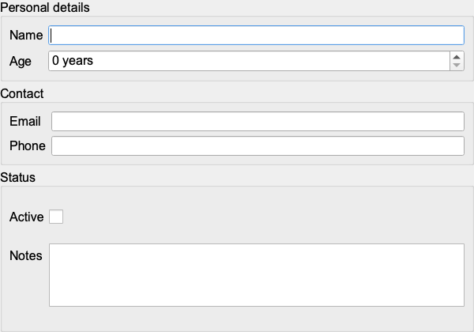
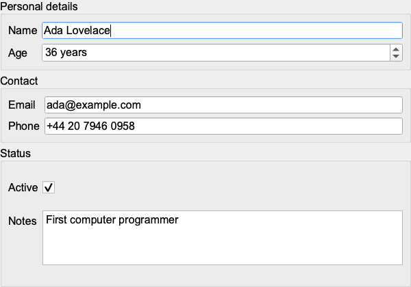

# pbform

Qt6 forms generated from Protocol Buffers messages.

`pbform` is a `protoc` plugin that creates a `QWidget` form class for every top-level message in a `.proto` file. It is designed for C++/Qt 6 applications that want editable, type-aware forms without hand-writing the widget layer.

The source repository is private. Released binaries are free to use, including in commercial applications; code generated by pbform may be used without restriction. See the license included in each download for the full terms.

## Download

Download the archive for your platform from the [latest release](https://github.com/farhosalo/pbform-release/releases/latest):

| Platform | Archive |
| --- | --- |
| Linux x86_64 | `pbform-linux-x86_64.tar.gz` |
| Linux ARM64 | `pbform-linux-aarch64.tar.gz` |
| macOS Apple Silicon | `pbform-macos-arm64.tar.gz` |
| macOS Intel | `pbform-macos-x86_64.tar.gz` |
| Windows x64 | `pbform-windows-x64.zip` |

The archives are portable; no installer is required. Extract one to any convenient location.

Each archive contains the plugin, the platform-appropriate `pbform-protoc` wrapper, this README, and the license. The Windows archive also includes the DLLs required by the plugin.

## What it generates

For a file named `person.proto`, run pbform alongside the normal C++ generator. The result is:

```text
person.pb.h / person.pb.cc           Standard Protobuf C++ code
person.qtform.h / person.qtform.cpp  Qt6 form code generated by pbform
```

For every top-level Protobuf message, the generated header declares a `<Message>Form` class in the message package's C++ namespace. Each form provides:

```cpp
void setMessage(const Message& message); // populate the widgets
void getMessage(Message& message) const; // write widget values back
```

The plugin itself does not depend on Qt. Qt 6 Widgets and the Protobuf C++ runtime are required only when compiling the generated code.

### Field mapping

| Protobuf field | Generated Qt widget |
| --- | --- |
| `string` | `QLineEdit` |
| `string` with `widget: "textarea"` | `QPlainTextEdit` |
| `bool` | `QCheckBox` |
| `enum` | `QComboBox` |
| `int32`, `uint32` | `QSpinBox` |
| `int64`, `uint64`, `float`, `double` | `QDoubleSpinBox` |
| supported top-level message | nested `<Message>Form` in a `QGroupBox` |

Labels, units, ranges, tooltips, ordering, grouping, and read-only state are supplied through comment annotations.

## Prerequisites

- `protoc` must be installed and available on `PATH` (or provided through `PROTOC`).
- To build generated forms: Qt 6 with the `Widgets` component, a C++ compiler, and the Protobuf C++ libraries.
- Linux and macOS plugin binaries are dynamically linked to Protobuf. Use a compatible Protobuf installation if the plugin fails to start because of a missing or incompatible library.
- The Windows archive includes the plugin's required DLLs, but not `protoc.exe`, Qt, or a C++ toolchain.

## Quick start

The complete runnable example is available in the [`example/`](example/) directory.

### 1. Describe a message

Comment annotations require no import and are the fastest way to get started:

```proto
syntax = "proto3";
package demo;

// This example keeps its UI metadata exclusively in @key comments.
// @title Edit person @table_name people @list_columns name,age,email
message Person {
  // @label Name @group Personal details @order 1
  string name = 1;

  // @label Age @unit years @min 0 @max 130 @group Personal details @order 2
  int32 age = 2;

  // @label Email @group Contact @order 3
  string email = 3;

  // @label Phone @group Contact @order 4
  string phone = 4;

  // @label Active @group Status @order 5
  bool active = 5;

  // @label Notes @widget textarea @group Status @order 6
  string notes = 6;
}
```

Annotations are optional. Without them, field names are used as labels and the default widget mapping applies.

### 2. Generate the code

From the directory containing `person.proto`:

```bash
mkdir -p gen
/path/to/pbform/pbform-protoc \
  --cpp_out=gen \
  --qtforms_out=gen \
  -I. \
  person.proto
```

`pbform-protoc` locates `protoc-gen-qtforms` automatically. Its location can be put on `PATH`, or supplied explicitly as above.

### 3. Use the form

```cpp
#include <QApplication>

#include "person.pb.h"
#include "person.qtform.h"

int main(int argc, char* argv[]) {
  QApplication app(argc, argv);

  demo::Person message;
  demo::PersonForm form;
  form.setMessage(message);
  form.show();

  const int result = app.exec();
  form.getMessage(message);
  return result;
}
```

`setMessage()` and `getMessage()` are explicit transfers; call `getMessage()` when you want to copy the current widget values into a Protobuf message.

### 4. Compile it

```cmake
cmake_minimum_required(VERSION 3.21)
project(my_app LANGUAGES CXX)

set(CMAKE_CXX_STANDARD 20)
set(CMAKE_CXX_STANDARD_REQUIRED ON)

find_package(Qt6 REQUIRED COMPONENTS Widgets)
find_package(Protobuf CONFIG REQUIRED)

add_executable(my_app
    main.cpp
    gen/person.pb.cc
    gen/person.qtform.cpp
)

target_include_directories(my_app PRIVATE gen)
target_link_libraries(my_app PRIVATE Qt6::Widgets protobuf::libprotobuf)
```

If your platform provides only CMake's Protobuf module, use `find_package(Protobuf REQUIRED)` and link the targets or libraries it supplies.

## Screenshots

The form generated from `example/person.proto` running in the Qt 6 application:

| Empty form | Populated form |
| :---: | :---: |
|  |  |

## Annotations

Use `@key value`. Multiple annotations may be written on a single comment line; values may contain spaces and end at the next `@key`.

```proto
// @title Recipe editor @table_name recipes @list_columns name,temperature
message Recipe {
  // @label Name @group General @order 10
  string name = 1;

  // @label Temperature @unit °C @min 0 @max 300 @group Process
  double temperature = 2;

  // @label Published @read_only true @db_index true
  bool published = 3;
}
```

| Scope | Supported keys |
| --- | --- |
| Field | `label`, `unit`, `min`, `max`, `group`, `widget`, `tooltip`, `order`, `read_only`, `db_index` |
| Message | `title`, `table_name`, `list_columns` |

`widget: "textarea"` is the currently supported widget override. `list_columns`, `table_name`, and `db_index` preserve metadata for downstream use; pbform currently generates forms, not database or table-view code.

## Platform notes

### Linux

Install Protobuf with your distribution's package manager, extract the matching archive, and run its wrapper:

```bash
sudo apt install protobuf-compiler  # Debian/Ubuntu
mkdir -p "$HOME/opt/pbform"
tar -xzf pbform-linux-x86_64.tar.gz -C "$HOME/opt/pbform"
chmod +x "$HOME/opt/pbform/protoc-gen-qtforms" "$HOME/opt/pbform/pbform-protoc"

"$HOME/opt/pbform/pbform-protoc" --cpp_out=gen --qtforms_out=gen -I. person.proto
```

Use the `linux-aarch64` archive on ARM64 systems. Release binaries are built on Ubuntu 24.04; a source build is the safest route for a significantly different Protobuf environment.

### macOS

Install Protobuf with Homebrew, then choose the `macos-arm64` archive for Apple Silicon or `macos-x86_64` for an Intel Mac:

```bash
brew install protobuf
mkdir -p "$HOME/opt/pbform"
tar -xzf pbform-macos-arm64.tar.gz -C "$HOME/opt/pbform"
chmod +x "$HOME/opt/pbform/protoc-gen-qtforms" "$HOME/opt/pbform/pbform-protoc"
xattr -dr com.apple.quarantine "$HOME/opt/pbform"

"$HOME/opt/pbform/pbform-protoc" --cpp_out=gen --qtforms_out=gen -I. person.proto
```

The binaries are unsigned. If macOS still blocks the plugin after removing the quarantine attribute, allow it in **System Settings → Privacy & Security**.

### Windows

Install `protoc` (for example, `choco install protoc`) and extract the archive:

```powershell
Expand-Archive .\pbform-windows-x64.zip -DestinationPath C:\pbform -Force
C:\pbform\pbform-protoc.bat --cpp_out=gen --qtforms_out=gen -I. person.proto
```

To compile the generated application, install Qt 6, the Protobuf C++ development files, and a compatible C++ toolchain such as MSVC or MSYS2/UCRT64.

## Direct `protoc` invocation

The wrapper is optional. Pass the plugin yourself when needed:

```bash
protoc \
  --plugin=protoc-gen-qtforms=/path/to/protoc-gen-qtforms \
  --cpp_out=gen \
  --qtforms_out=gen \
  -I. \
  person.proto
```

For Protobuf 3.12–3.14, also pass `--experimental_allow_proto3_optional`. The supplied wrappers pass that flag automatically.

### Wrapper environment variables

| Variable | Purpose |
| --- | --- |
| `PROTOC` | Path or command name for `protoc` |
| `PBFORM_PLUGIN_EXECUTABLE` | Path to `protoc-gen-qtforms` |

Normally none of these need to be set: the wrapper resolves the plugin relative to itself.

## Current limitations

- `repeated` and `map` fields, `oneof` fields, and `bytes` fields are rendered as unsupported placeholders.
- Google well-known types and nested message declarations (for example, `Outer.Inner`) are not supported as form fields.
- Recursive message fields are not supported.
- `int64` and `uint64` use `QDoubleSpinBox`, so values are precise only to approximately 9e15.
- Protobuf field names that conflict with C++ keywords are not handled by the generator.

## Help and issues

For installation problems or bugs, open an issue in the [pbform release repository](https://github.com/farhosalo/pbform-release/issues). Please include your operating system, Protobuf version, the relevant `.proto` file, and the complete error message.
